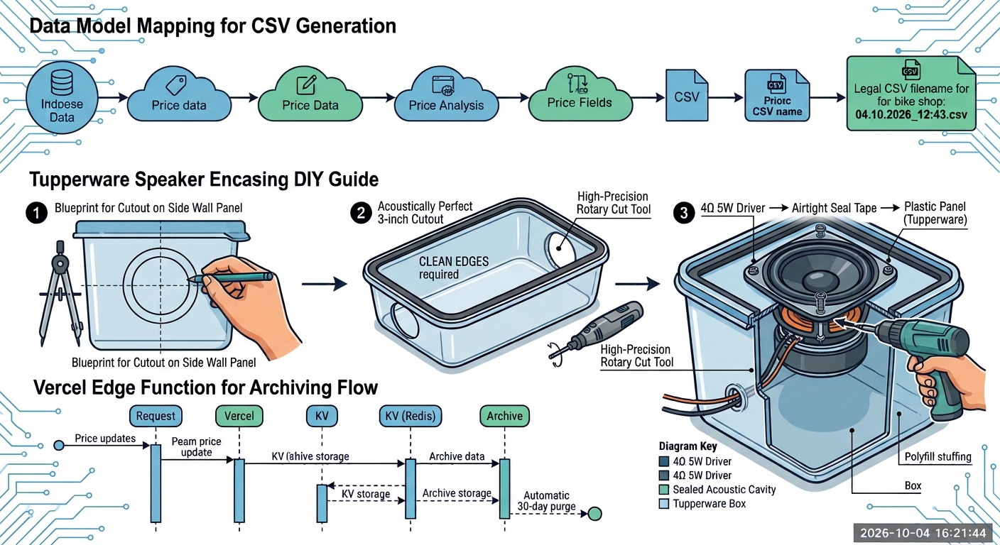
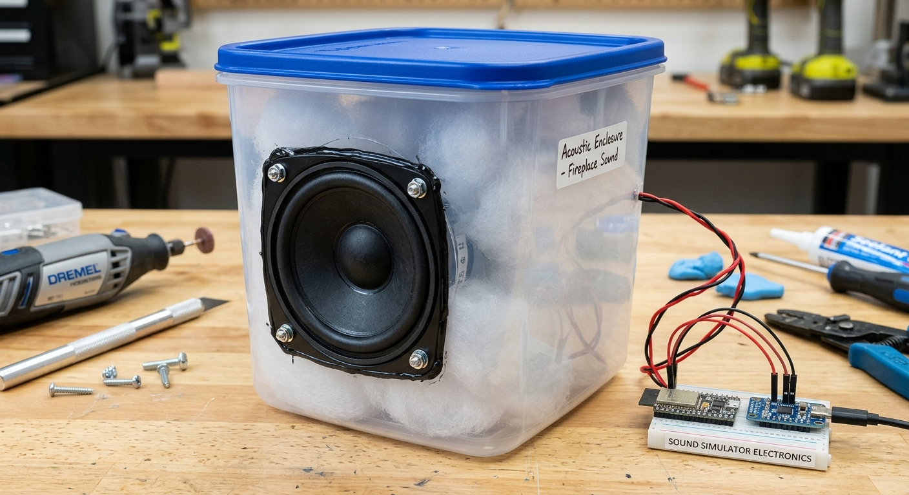

# Fireplace Sound System

ESP32-S3-N16R8 + MAX98357A I2S amplifier, streamed by Home Assistant via ESPHome.

## Wiring

| MAX98357A | ESP32-S3   | Function                    |
|-----------|------------|-----------------------------|
| VIN       | 3.3V       | Power input — use 3.3V, NOT 5V |
| GND       | GND        | Common ground               |
| DIN       | GPIO18     | I2S serial data out         |
| BCLK      | GPIO5      | I2S bit clock               |
| LRC (WS)  | GPIO4      | I2S word select (L/R clock) |
| GAIN      | floating   | +9 dB (tie to GND = +3 dB, VIN = +15 dB) |
| SD/MODE   | 3.3V       | Tie high to enable the amp  |
| SPK +/-   | speaker    | 4Ω/8Ω — never connect to GND |

Power the ESP32-S3 via USB; take the amp's VIN from the board's **3.3V** rail.

> **Why 3.3V and not 5V:** the MAX98357A's logic-high threshold scales with its
> supply voltage. At 5V it needs ~3.5V on BCLK/LRC/DIN, but the ESP32-S3 outputs
> only 3.3V, so the amp never registers a valid "high" and stays silent. At 3.3V
> supply the amp runs within its 2.5–5.5V range and reliably detects the logic.

## Louder / better sound (upgrade path)

The amp tops out at ~1.4 W into 4Ω at 3.3V. For more:

- **4Ω speaker** (3"–4", 3–10 W, sensitivity ≥85 dB/W/m) → ~2× power vs 8Ω.
- **Sealed enclosure** for the speaker — restores bass/body (bare drivers sound thin).
- **5V supply + level shifter** → full ~3.2W. A level shifter (BSS138 4-channel
  module, or 74LVC245/74AHCT125) translates the ESP32's 3.3V I2S lines to 5V:

  | Level shifter | Connect to |
  |---------------|-----------|
  | HV (high side) | 5V (amp VIN rail) |
  | LV (low side)  | 3.3V (ESP32 rail) |
  | GND            | common ground |
  | BCLK, LRC, DIN (3 channels) | ESP32 GPIO5/GPIO4/GPIO18 (LV) → MAX98357A (HV) |

  Then move MAX98357A `VIN` to **5V** and keep `GAIN` floating (+9 dB — +15 dB clips).
  No firmware change needed; the ESP32 still outputs 3.3V logic.

Note: a 74HC595 is a **shift register**, not a level shifter — it won't work here.

**Don't mix 8Ω + 4Ω speakers** on the same mono channel: the 4Ω draws ~2× the
power, so they'd play unevenly; in parallel the load drops below 4Ω and can
overheat the amp; in series (12Ω) output collapses. Use one matched 4Ω driver.

### Speaker enclosure (Tupperware sealed box)

A bare driver cancels its own bass; a sealed enclosure restores the low-end body.
Build: a rigid plastic food container + 3" driver, fully airtight.

1. **Cutout** — trace the driver's inner cone (~70–75 mm) onto a wall/lid, cut with
   a Dremel/hobby knife, deburr, and drill 4 corner screw holes.
2. **Mount + seal** — foam tape/hot-glue/silicone around the rim; screw the driver
   in tight. The box must be **completely airtight** (leaks kill the bass).
3. **Wire exit** — drill a small hole for the speaker wires, feed through, seal
   with hot glue.
4. **Dampen** — add a loose handful of polyfill/cotton wool inside before sealing,
   then snap the lid shut.





## Audio files

The media player is configured for **MP3** (mono, 44.1 kHz, 128 kbps). Ready-made
clips are in `sounds/`:

- `fireplace_1.mp3`
- `fireplace_3.mp3`
- `cozy_fireplace.mp3`
- `fire_crackling_bbq.mp3`
- `fireplace_heavy.mp3`
- `living_room_fireplace.mp3`

Copy them into Home Assistant's `/config/www/sounds/`:

```bash
/config/www/sounds/fireplace_1.mp3
```

They are served at `http://<HA_IP>:8123/local/sounds/<name>.mp3`.

To add a sound, drop a mono 44.1 kHz MP3 into `/config/www/sounds/` and add its
name to the `input_select.fireplace_sound` options.

## Flashing

1. Edit `fireplace-sound.yaml`: set `wifi.ssid`, `wifi.password`.
2. Open the ESPHome dashboard (HA → Settings → Add-ons → ESPHome → Open Web UI).
3. **New device** → name `fireplace-sound` → select **ESP32-S3** → edit → paste the YAML.
4. First flash: connect the S3 via USB and use the ESPHome **web flasher**
   (`https://web.esphome.io`, browser WebSerial) or download the compiled `.bin`
   from the dashboard and flash with esptool.
5. In Home Assistant, **adopt** the device. It appears as `media_player.fireplace_sound_player_fireplace_sound`.

## Home Assistant automations

Add the `input_select` and `input_boolean` from the top of `automation.yaml`
into `configuration.yaml`, then paste the automation into `automations.yaml`
(or add via Settings → Automations → YAML edit). Replace `<HA_IP>` with your
Home Assistant host IP.

- `input_select.fireplace_sound` — pick which sound to play (persistent).
- `input_boolean.fireplace_sound_enabled` — the on/off toggle (persistent).

Both live in Home Assistant (always powered), so their state survives the ESP32
resetting or losing power. The control automation plays the selected sound when
`switch.fireplace_master` is on **and** `fireplace_sound_enabled` is on, and stops
otherwise.

## Verification

1. Flash `test/i2s_tone_test/i2s_tone_test.ino` first to confirm the amp + speaker
   output a clean tone (no HA/Wi-Fi required).
2. After flashing ESPHome, play a test clip on `media_player.fireplace_sound_player_fireplace_sound` and
   confirm clean audio and a working volume slider.
3. Toggle `switch.fireplace_master` and confirm the sound starts/stops.
